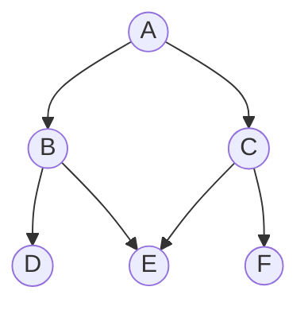

# BFS 與 DFS：兩種走完一張圖的方法

## 先講結論

BFS 和 DFS 都是「把一張圖的每個點走過一遍」的方法，差別在於**先走哪裡**：

| | BFS（廣度優先） | DFS（深度優先） |
| --- | --- | --- |
| 走法 | 一圈一圈往外擴散 | 一條路走到底，再退回來 |
| 比喻 | 石頭丟進水裡的漣漪 | 走迷宮 |
| 怎麼記住接下來要去哪 | 排隊：先排的先走 | 疊盤子：最後疊上的先拿 |
| 適合 | 找「最少幾步」能到 | 走完所有可能、判斷有沒有環 |
| 花的時間 | O(V + E) | O(V + E) |

---

## 什麼是「圖」

這裡的「圖」不是照片，而是「一些點，用線或箭頭連起來」的結構：

- 捷運路線：車站是點，相鄰兩站之間的路線是線。
- 社群網站：每個人是點，「是朋友」是線。
- 網頁：每個網頁是點，網頁上的連結是箭頭。

這篇用下面這張圖當例子：A 可以到 B 和 C，B 可以到 D 和 E，C 可以到 E 和 F。



---

## BFS：一圈一圈往外擴散

**比喻**：石頭丟進水裡，漣漪一圈一圈往外擴散。先走完所有「隔一步」的點，再走「隔兩步」的點，以此類推。

**怎麼記住接下來要去哪**：排隊。發現新的點，就排到隊伍最後面；每次從隊伍最前面叫一個出來拜訪。先排的先走，所以近的點一定比遠的點先被拜訪。

| 步驟 | 拜訪 | 發現新的點，排到隊伍後面 | 隊伍 |
| --- | --- | --- | --- |
| 0 | — | 把起點 A 排進去 | A |
| 1 | A | B、C | B, C |
| 2 | B | D、E | C, D, E |
| 3 | C | F（E 已經在排隊了，不重複排） | D, E, F |
| 4 | D | 沒有 | E, F |
| 5 | E | 沒有 | F |
| 6 | F | 沒有 | （空） |

**拜訪順序：A → B → C → D → E → F**

按照距離 A 幾步來看，剛好一圈一圈往外：

| 距離 A | 點 |
| --- | --- |
| 0 步 | A |
| 1 步 | B、C |
| 2 步 | D、E、F |

---

## DFS：一條路走到底

**比喻**：走迷宮。選一條路一直走到底，走不通就退回上一個岔路，換另一條走。

**怎麼記住接下來要去哪**：疊盤子。每走進一個點就疊上一個盤子，走到底要退回時，拿掉最上面那個。疊著的盤子，就是「從起點走到現在這條路」。

| 步驟 | 動作 | 目前這條路 |
| --- | --- | --- |
| 1 | 拜訪 A | A |
| 2 | A 的第一個出口是 B，走進去，拜訪 B | A → B |
| 3 | B 的第一個出口是 D，繼續往深處走，拜訪 D | A → B → D |
| 4 | D 沒有出口，退回 B | A → B |
| 5 | B 的下一個出口是 E，走進去，拜訪 E | A → B → E |
| 6 | E 沒有出口，退回 B；B 的出口都走完，退回 A | A |
| 7 | A 的下一個出口是 C，走進去，拜訪 C | A → C |
| 8 | C 的出口 E 已經拜訪過，跳過；下一個出口是 F，拜訪 F | A → C → F |
| 9 | F 沒有出口，一路退回 A，全部走完 | （空） |

**拜訪順序：A → B → D → E → C → F**

---

## 兩種順序放在一起比

| | 第 1 個 | 第 2 個 | 第 3 個 | 第 4 個 | 第 5 個 | 第 6 個 |
| --- | --- | --- | --- | --- | --- | --- |
| BFS | A | B | **C** | D | E | F |
| DFS | A | B | **D** | E | C | F |

差別從第 3 個開始：拜訪完 B 之後，BFS 先去同一圈的 C，DFS 則繼續往 B 的深處走到 D。

---

## 什麼時候用哪一個

### BFS：找「最少幾步」

因為 BFS 一定先走完近的點，再走遠的點，所以**第一次碰到目標時，走的一定是最少步數**。

| 情境 | 問題 |
| --- | --- |
| 捷運轉乘 | 從 A 站到 B 站，最少要搭幾站？ |
| 社群網站 | 我和某個人之間，隔了幾層「朋友的朋友」？ |
| 迷宮 | 從入口到出口，最短要走幾步？ |
| 推薦好友 | 先推薦隔一層的人，再推薦隔兩層的人 |

### DFS：走完所有可能、追蹤一條路

DFS 會沿著一條路走到底，隨時都知道「從起點走到現在這條路」，所以適合需要追蹤路徑的問題。

| 情境 | 問題 |
| --- | --- |
| 判斷有沒有環 | Excel 有沒有循環參照？選課先修有沒有互相卡住？（白灰黑三色法就是 DFS） |
| 決定做事的順序 | 套件要先裝哪一個？資料處理要先跑哪一步？ |
| 數有幾塊 | 地圖上有幾座島？社群裡有幾個互不相連的小圈圈？ |
| 走迷宮、解謎 | 找出一條能走到出口的路（不一定最短） |

只是要「把每個點都走過一次」的話，兩種都可以。

---

## 為什麼都是 O(V + E)

V 是點的數量，E 是線（箭頭）的數量。

- 兩種方法都會記住「拜訪過哪些點」，所以**每個點只拜訪一次**，共 V 次。
- 拜訪一個點時，會把它的每條線都看一次，決定要不要往那邊走。所有點的線加起來，**每條線只看一次**，共 E 次。

總共是 V + E。圖的大小由點和線兩個東西決定，所以兩個都要寫出來。

---

## 程式碼

### 用字典寫下一張圖

鍵是起點，值是一個 list，列出它可以走到哪些點：

```python
g = {
    "A": ["B", "C"],
    "B": ["D", "E"],
    "C": ["E", "F"],
    "D": [],
    "E": [],
    "F": [],
}
```

### BFS

用 `deque` 當作排隊的隊伍：`append` 排到最後面，`popleft` 從最前面叫一個出來。

```python
from collections import deque

def bfs(g, start):
    visited = {start}           # 已經排過隊的點，避免重複排
    queue = deque([start])      # 排隊的隊伍
    order = []                  # 拜訪順序
    while queue:                # 隊伍還有人就繼續
        u = queue.popleft()     # 從最前面叫一個出來
        order.append(u)         # 拜訪它
        for v in g[u]:          # 看它能走到哪些點
            if v not in visited:
                visited.add(v)
                queue.append(v)     # 新的點排到最後面
    return order

print(bfs(g, "A"))   # ['A', 'B', 'C', 'D', 'E', 'F']
```

### DFS

用遞迴：走進下一個點，就是呼叫 `dfs`；那個點的出口都走完，`dfs` 結束，就自動回到上一個點繼續。

```python
def dfs(g, u, visited, order):
    visited.add(u)              # 記下拜訪過
    order.append(u)             # 拜訪它
    for v in g[u]:              # 一個出口一個出口試
        if v not in visited:
            dfs(g, v, visited, order)   # 走進去，走到底才會回來

order = []
dfs(g, "A", set(), order)
print(order)         # ['A', 'B', 'D', 'E', 'C', 'F']
```

---

## 常見問題

**Q：為什麼一定要記住拜訪過哪些點？**
不記的話，遇到兩條路通往同一個點（例如 B 和 C 都能到 E），E 會被拜訪兩次。如果圖裡有環，甚至會一直繞圈、永遠停不下來。

**Q：拜訪順序是固定的嗎？**
不一定。同一個點有好幾個出口時，先試哪一個會影響順序。例如把 A 的出口改成 `["C", "B"]`，BFS 就變成 A → C → B → ……。不過「BFS 一圈一圈、DFS 一條到底」的特性不會變。

**Q：BFS 找到的最少步數，就是最短距離嗎？**
只有每一步的成本都一樣時才是。例如捷運「最少搭幾站」可以用 BFS；但如果每段路的時間不同，要找「最省時間」的路，就要用其他方法（見進階）。

---

## 進階

### 用 BFS 算出每個點離起點幾步

把「距離」記在字典裡：新發現的點，距離就是「目前這個點的距離 + 1」。

```python
from collections import deque

def distances(g, start):
    dist = {start: 0}
    queue = deque([start])
    while queue:
        u = queue.popleft()
        for v in g[u]:
            if v not in dist:
                dist[v] = dist[u] + 1
                queue.append(v)
    return dist

print(distances(g, "A"))   # {'A': 0, 'B': 1, 'C': 1, 'D': 2, 'E': 2, 'F': 2}
```

### 不用遞迴的 DFS

遞迴其實就是電腦幫你疊盤子。也可以自己用 list 當成一疊盤子：`append` 疊上去，`pop` 拿最上面那個。

```python
def dfs_stack(g, start):
    visited = set()
    stack = [start]
    order = []
    while stack:
        u = stack.pop()                 # 拿最上面的盤子
        if u in visited:
            continue
        visited.add(u)
        order.append(u)
        for v in reversed(g[u]):        # 反過來疊，第一個出口才會最先被拿到
            if v not in visited:
                stack.append(v)
    return order

print(dfs_stack(g, "A"))   # ['A', 'B', 'D', 'E', 'C', 'F']
```

圖很大、路很深時，遞迴版本可能超過 Python 的遞迴層數上限（預設約 1,000 層），這時就要改用這種寫法。

### BFS 和 DFS 唯一的差別

比較 `bfs` 和 `dfs_stack`，結構幾乎一模一樣，差別只在**從哪一端拿下一個點**：

| | 容器 | 拿哪一個 |
| --- | --- | --- |
| BFS | 佇列（排隊） | 最早放進去的（`popleft`） |
| DFS | 堆疊（疊盤子） | 最晚放進去的（`pop`） |

### 每段路成本不同時

BFS 只適合每一步成本都一樣的情況。如果每段路的距離或時間不同（例如地圖導航），要找最短路線，會用 **Dijkstra 演算法**。它的概念像 BFS，但每次優先處理「目前累積成本最小」的點，而不是「最早排隊」的點。
