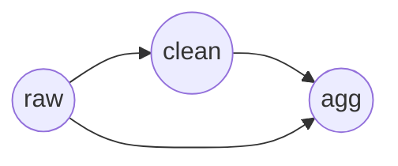
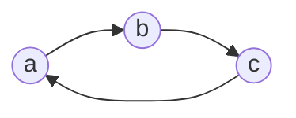

# 用白、灰、黑三色判斷圖有沒有環：程式篇

## 先複習規則

用「一條路先走到底，走不通再退回來」的方式（DFS）探索每個點：

| 時機 | 動作 |
| --- | --- |
| 走進一個點 | 塗成**灰色**（在目前這條路上） |
| 這個點的所有出口都走完，準備退回 | 塗成**黑色**（已經走完） |
| 還沒去過的點 | **白色** |

往前走時遇到的點：

| 遇到 | 怎麼做 |
| --- | --- |
| 白色 | 走進去探索 |
| 灰色 | 走回這趟路上的點 → **有環** |
| 黑色 | 以前走完的 → 跳過，不算環 |

---

## 用程式寫下一張圖

這篇用兩張圖當例子。

**例一（沒有環）**：raw 指向 clean 和 agg，clean 也指向 agg。



**例二（有環）**：a 指向 b，b 指向 c，c 又指回 a。



在 Python 裡，通常用**字典**把箭頭記下來：鍵是起點，值是一個 list，列出它指向哪些點。例一寫成：

```python
g = {
    "raw": ["clean", "agg"],   # raw 有箭頭指向 clean 和 agg
    "clean": ["agg"],          # clean 有箭頭指向 agg
    "agg": [],                 # agg 沒有指向任何點
}
```

想知道從某個點可以走到哪裡，就查字典：

```python
print(g["raw"])     # ['clean', 'agg']
print(g["agg"])     # []，沒有路可以走
```

---

## 為什麼只用一個 set 不夠

常見的錯誤寫法是只記「去過」和「沒去過」：

```python
g = {"raw": ["clean", "agg"], "clean": ["agg"], "agg": []}
seen = set()

def bad(u):
    if u in seen:
        return True          # 去過就說有環
    seen.add(u)
    for v in g[u]:
        if bad(v):
            return True
    return False

print(bad("raw"))            # True ← 誤判
```

這個寫法只有兩種狀態，把**灰色**（在路上）和**黑色**（已走完）混在一起了。從 raw 走第二條路到 agg 時，agg 明明是「以前走完的」，卻被當成「又走回來了」，於是誤判成有環。

| 寫法 | 狀態 | 從 raw 第二次走到 agg | 結果 |
| --- | --- | --- | --- |
| 一個 set | 去過 / 沒去過 | 去過 → 有環 | 錯 |
| 三色 | 白 / 灰 / 黑 | 黑 → 跳過 | 對 |

---

## 程式碼

### 三色版本

```python
WHITE, GRAY, BLACK = 0, 1, 2

def dfs(g, color, u):
    color[u] = GRAY                      # 走進房間：畫灰色
    for v in g[u]:                       # 一扇一扇門試
        if color[v] == GRAY:             # 前面是灰色 → 走回這趟路上 → 有環
            return True
        if color[v] == WHITE:            # 前面是白色 → 走進去探索
            if dfs(g, color, v):         # 裡面發現環，就一路往回報告
                return True
        # 前面是黑色 → 兩個 if 都不成立，直接跳過
    color[u] = BLACK                     # 所有門都試過：改成黑色
    return False                         # 退出房間，回到上一個房間

def has_cycle(g):
    color = {}
    for u in g:
        color[u] = WHITE                 # 一開始全部是白色
    for u in g:                          # 每個還沒去過的點，都當一次起點
        if color[u] == WHITE:
            if dfs(g, color, u):
                return True
    return False
```

### 程式裡的「走進房間」和「退出房間」

`dfs` 在自己裡面又呼叫了 `dfs`，這叫做**遞迴**。對照迷宮比喻：

| 迷宮比喻 | 程式 |
| --- | --- |
| 走進一個房間 | 呼叫 `dfs(g, color, 那個點)` |
| 在地上畫灰色 | `color[u] = GRAY` |
| 一扇一扇門試 | `for v in g[u]:` |
| 退出房間，回到上一個房間 | `return`，回到上一層 `dfs` 剛才停下來的地方 |

重點是：**走進下一個房間時，上一個房間的探索只是暫停，並沒有結束。**等下一個房間 `return` 回來，上一個房間會從剛才停下的那扇門繼續試下一扇。

這很像疊盤子：每走進一個房間就疊上一個盤子，退出時拿掉最上面那個。**疊著的那些盤子，就是灰色的點。**

用例一實際看一次呼叫順序：

| 順序 | 程式在做什麼 | 比喻 | 疊著的盤子（灰色） |
| --- | --- | --- | --- |
| 1 | `has_cycle` 呼叫 `dfs(raw)` | 走進 raw | raw |
| 2 | `dfs(raw)` 看到 clean 是白色，呼叫 `dfs(clean)` | 走進 clean，raw 暫停 | raw、clean |
| 3 | `dfs(clean)` 看到 agg 是白色，呼叫 `dfs(agg)` | 走進 agg，clean 暫停 | raw、clean、agg |
| 4 | `dfs(agg)` 沒有門可試，塗黑，`return False` | 退出 agg，回到 clean | raw、clean |
| 5 | `dfs(clean)` 收到 False，門都試完了，塗黑，`return False` | 退出 clean，回到 raw | raw |
| 6 | `dfs(raw)` 繼續試下一扇門：agg 是黑色，跳過 | 不進去 | raw |
| 7 | `dfs(raw)` 門都試完了，塗黑，`return False` | 退出 raw | （空） |
| 8 | `has_cycle` 發現其他點都不是白色，`return False` | 結束：沒有環 | （空） |

### 兩本簿子版本（意思完全一樣）

如果「三種顏色」太抽象，可以換成兩本簿子：

- `on_path`（這趟路上）：走進一個點就寫上，退出時擦掉。等於**灰色**。
- `done`（已完成）：一個點的所有出口都走完，就寫上。等於**黑色**。
- 兩本都沒寫的點，等於**白色**。

```python
def dfs(g, on_path, done, u):
    on_path.add(u)                       # 走進來，寫上「這趟路上」
    for v in g[u]:
        if v in on_path:                 # 又遇到這趟路上的點 → 有環
            return True
        if v not in done:                # 沒走過 → 走進去
            if dfs(g, on_path, done, v):
                return True
    on_path.remove(u)                    # 要退出了，從「這趟路上」擦掉
    done.add(u)                          # 寫上「已完成」
    return False

def has_cycle(g):
    on_path = set()     # 灰色：目前這條路上的點
    done = set()        # 黑色：已經完全走完的點
    for u in g:
        if u not in done:
            if dfs(g, on_path, done, u):
                return True
    return False
```

### 兩個例子實際跑出來

```python
g1 = {"raw": ["clean", "agg"], "clean": ["agg"], "agg": []}
g2 = {"a": ["b"], "b": ["c"], "c": ["a"]}

print(has_cycle(g1))   # False：沒有環
print(has_cycle(g2))   # True：有環
```

---

## 常見問題

**Q：`has_cycle` 為什麼要每個點都試一次當起點？**
因為圖可能分成好幾塊互不相連的部分，只從一個點出發，可能走不到另一塊。所以每個還是白色的點都要當一次起點；已經不是白色的點，代表探索過了，會直接略過。

**Q：`dfs` 裡面發現環以後，為什麼要一路 `return True`？**
發現環的那一層 `dfs` 回傳 True，上一層收到 True 就跟著回傳 True，一層一層往回報告，直到 `has_cycle`。就像迷宮最深處的人發現繞圈了，沿路喊回去，每個房間都不必再試剩下的門。

---

## 進階

### 這個方法要花多少時間？

每個點只會從白變灰、再從灰變黑一次，每個箭頭也只會被檢查一次，所以是 **O(V + E)**：V 是點的數量，E 是箭頭的數量。

### 沒有環之後：決定做事的順序

確定沒有環，下一個問題通常是「該照什麼順序做」：Excel 要先算哪一格、選課要先修哪一門、套件要先裝哪一個。這叫做**拓撲排序**。

三色法剛好可以順便算出來：**記下每個點變黑的順序，倒過來就是一個可行的做事順序。**例一變黑的順序是 agg → clean → raw，倒過來 raw → clean → agg，正好就是「先有原始資料，再清理，最後彙總」。

### 沒有方向的圖（例如朋友關係）

A 和 B 互相是朋友，線沒有方向。這種圖不能直接用三色法：A—B 這條線從 B 看回去就是 A，A 還是灰色，會被誤判成環。

沒有方向的圖通常改成「記住自己是從哪個點來的」：遇到已經去過、而且不是自己來源的點，才算環。

### 簡短寫法

熟悉 Python 之後，常會看到更精簡的寫法：把 `dfs` 放在 `has_cycle` 裡面，用 `any(...)` 取代 `for` 迴圈。意思和上面的三色版本完全一樣：

```python
def has_cycle(g):
    WHITE, GRAY, BLACK = 0, 1, 2
    color = {u: WHITE for u in g}

    def dfs(u):
        color[u] = GRAY
        for v in g[u]:
            if color[v] == GRAY:
                return True
            if color[v] == WHITE and dfs(v):
                return True
        color[u] = BLACK
        return False

    return any(color[u] == WHITE and dfs(u) for u in g)
```

- `{u: WHITE for u in g}`：一行建出「每個點都是白色」的字典。
- `any(...)`：只要其中一個是 True 就回傳 True，等於前面那個 `for` 迴圈加上 `return True`。
- `dfs` 寫在 `has_cycle` 裡面，可以直接用外面的 `g` 和 `color`，不必每次都當參數傳進去。
