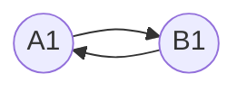
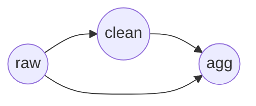
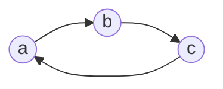
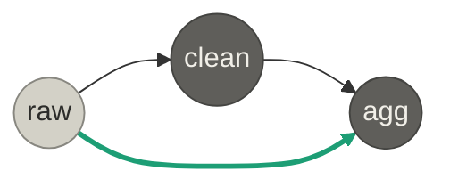
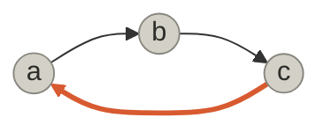
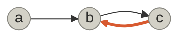

# 用白、灰、黑三色判斷圖有沒有環

## 先講結論

判斷有沒有「繞圈」，關鍵在於：**再次遇到同一個點時，它是在「我現在這條路上」，還是「以前別條路走過、已經走完了」？**

- 在現在這條路上 → 我又走回來了 → **有環**。
- 以前走完的 → 只是兩條路剛好經過同一個點 → **不是環**。

白、灰、黑三種顏色，就是用來分辨這兩種情況。

---

## 為什麼要找環

先看一個幾乎每個人都碰過的例子：**Excel 的循環參照**。

在 Excel 裡輸入：

- A1 儲存格：`= B1 + 1`
- B1 儲存格：`= A1 + 1`

Excel 會跳出「循環參照」的警告。因為要算 A1，得先知道 B1；要算 B1，又得先知道 A1。兩格互相等待，永遠算不出來。

箭頭代表「需要先知道」：A1 指向 B1，表示算 A1 需要先知道 B1。

這種「互相等待、永遠做不完」的情況就是**環**。只要事情之間有「A 要等 B 先完成」的關係，就可能出現環：

| 情境 | 環長什麼樣子 | 發生什麼事 |
| --- | --- | --- |
| Excel 公式 | A1 = B1 + 1，B1 = A1 + 1 | 跳出「循環參照」警告，算不出來 |
| 選課先修 | 修 A 要先修 B，修 B 又要先修 A | 這兩門課永遠沒人能修 |
| 安裝套件 | 套件 A 需要 B，B 又需要 A | 不知道該先裝哪個 |
| Python import | a.py 匯入 b.py，b.py 又匯入 a.py | 出現 circular import 錯誤 |
| 資料處理流程 | 報表要等彙總表，彙總表又要等報表 | 排程卡死，永遠跑不完 |

Excel、選課系統、套件管理工具、排程工具，在開始做事之前都會先檢查有沒有環，有的話就提早警告，而不是卡住。這篇要學的，就是它們用來檢查的方法。

---

## 什麼是「圖」和「環」

這裡的「圖」不是照片，而是「一些點，用箭頭連起來」的結構。箭頭代表「要先做完前面，才能做後面」。

例如資料處理流程：原始資料 raw 清理後變成 clean，clean 再彙總成 agg，raw 也會直接拿來算 agg。

**環**就是沿著箭頭走，能回到出發點。例如：

---

## 生活比喻：拿著粉筆走迷宮

每個點是一個房間，每個箭頭是一扇只能單向通過的門。你拿著粉筆，用「一條路先走到底，走不通再退回來」的方式探索。這種走法叫 **DFS（深度優先搜尋）**。

- **走進一個房間**：在地上畫**灰色**記號，意思是「我正在這裡，還沒探索完」。
- **這個房間的每扇門都試過了，準備退出去**：把灰色改成**黑色**，意思是「這間已經完全探索過，從這裡出去不會繞回來」。
- **還沒去過的房間**：地上什麼都沒有，就是**白色**。

往前走時，看到下一個房間地上的記號：

| 看到 | 意思 | 怎麼做 |
| --- | --- | --- |
| 白色 | 沒去過 | 走進去探索 |
| 灰色 | 這是我**這一趟路上**才剛經過的房間，我又走回來了 | **有環**，結束 |
| 黑色 | 以前探索完的房間，從那裡出去不會繞回我身上 | 不用再進去，跳過，**不算環** |

**一句話記住：灰色的點，就是「從起點走到現在這條路上」的所有點。**

---

## 例一：沒有環（兩條路共用終點）

| 步驟 | 動作 | raw | clean | agg | 目前這條路 |
| --- | --- | --- | --- | --- | --- |
| 0 | 一開始 | 白 | 白 | 白 | （空） |
| 1 | 走進 raw | 灰 | 白 | 白 | raw |
| 2 | raw → clean，clean 是白色，走進去 | 灰 | 灰 | 白 | raw → clean |
| 3 | clean → agg，agg 是白色，走進去 | 灰 | 灰 | 灰 | raw → clean → agg |
| 4 | agg 沒有出口，塗黑，退回 clean | 灰 | 灰 | **黑** | raw → clean |
| 5 | clean 的出口都走完，塗黑，退回 raw | 灰 | **黑** | 黑 | raw |
| 6 | raw → agg，**agg 是黑色 → 跳過** | 灰 | 黑 | 黑 | raw |
| 7 | raw 的出口都走完，塗黑 | **黑** | 黑 | 黑 | （空） |

結果：全部走完都沒遇到灰色，**沒有環**。

**關鍵在第 6 步**。這時 raw 是灰色（還在路上），clean 和 agg 都是黑色（已走完）。綠色箭頭指向黑色的 agg，所以跳過：

---

## 例二：有環

| 步驟 | 動作 | a | b | c | 目前這條路 |
| --- | --- | --- | --- | --- | --- |
| 0 | 一開始 | 白 | 白 | 白 | （空） |
| 1 | 走進 a | 灰 | 白 | 白 | a |
| 2 | a → b，b 是白色，走進去 | 灰 | 灰 | 白 | a → b |
| 3 | b → c，c 是白色，走進去 | 灰 | 灰 | 灰 | a → b → c |
| 4 | c → a，**a 是灰色 → 有環** | 灰 | 灰 | 灰 | a → b → c |

**關鍵在第 4 步**。三個點都是灰色，代表都在目前這條路上。橘紅色箭頭從 c 指回灰色的 a，代表走回了自己這一趟經過的地方：

---

## 為什麼一定要分灰色和黑色

如果只記「去過」和「沒去過」兩種狀態，會把灰色和黑色混在一起。

回到例一的第 6 步：從 raw 走到 agg 時，agg 已經去過了。只看「去過沒」的話，會以為「又走回來了，有環」。但 agg 其實是黑色，是以前從 clean 那條路走完的，跟現在這條路無關。raw → clean → agg 和 raw → agg 只是兩條路剛好通往同一個地方，就像從家可以直接去公司，也可以先繞去早餐店再去公司，這不代表你在繞圈子。

所以要分成三種狀態：

| 再次遇到的點是 | 代表 | 結論 |
| --- | --- | --- |
| 灰色 | 在我現在這條路上 | 有環 |
| 黑色 | 以前別條路走完的 | 不是環，跳過 |

---

## 發現有環之後怎麼辦

找到環只是第一步。程式只負責發現，要怎麼處理得由人來判斷：先找出是哪幾個點繞成一圈，再決定拆掉哪一個依賴關係。

### 第一步：找出是哪幾個點繞成一圈

只知道「有環」還不夠，要知道是誰卡住誰才能修。三色法剛好可以順便找出來：遇到灰色的點時，**從那個點到目前位置的這段路**，就是環。

例如 a → b → c，c 又指回 b。走到 c 時，這條路是 a → b → c。c 指向灰色的 b，從 b 開始截取這段路，得到環 b → c → b。a 不在環上，只是剛好在通往環的路上。

### 第二步：拆掉環

環代表「互相等待」，一定要拆掉其中一個依賴才能繼續。常見的拆法有四種：

| 拆法 | 什麼時候用 | 例子 |
| --- | --- | --- |
| 刪掉多餘的依賴 | 其中一條關係其實是設定錯誤 | 選課規定寫錯了，B 根本不需要先修 A |
| 抽出共同的部分 | A 和 B 互相需要對方的「某一部分」 | a.py 和 b.py 互相 import，把兩邊都需要的函式搬到新的 common.py |
| 合併成一步 | A 和 B 本來就分不開 | 兩門課改成「同時修」 |
| 用時間切開 | 需要的是對方「之前」的結果 | 今天的報表改用昨天的彙總表，就不必等今天的彙總表 |

### 各種情境的處理方式

| 情境 | 怎麼處理 |
| --- | --- |
| Excel 循環參照 | 用「公式 → 錯誤檢查 → 循環參照」找出是哪幾格，通常是某個公式不小心參照到自己的結果，改掉那個公式 |
| 選課先修 | 檢查先修規定，通常是其中一條寫錯，或改成「同時修」 |
| 安裝套件 | 調整套件版本，或回報給套件作者；很多套件管理工具會自動處理 |
| Python 循環 import | 把共用的程式搬到第三個檔案，或把 import 移到函式裡面 |
| 資料處理流程 | 改用前一天的資料，或把卡住的那一步拆成兩步 |

重點是：偵測環很機械，拆環需要判斷。程式能告訴你「b 和 c 互相卡住」，但該拆 b → c 還是 c → b，要看哪個依賴才是真正必要的。

---

## 常見問題

**Q：「走回灰色」是任何一個灰色都算嗎？還是一定要走回起點？**
任何一個灰色都算，不一定是起點。灰色的點全都在「從起點走到現在」這條路上，走回其中任何一個，就代表從那個點出發繞了一圈又回到它。

例如 a → b → c，c 又指回 b：

走到 c 時，a、b、c 都是灰色。c 指向 b，b 是灰色，所以有環。這個環是 b → c → b，跟起點 a 沒有關係，a 只是剛好在通往這個環的路上。

**Q：黑色的點為什麼可以放心跳過？**
一個點會變成黑色，代表從它出發能走到的地方都已經探索完，而且過程中沒有發現環（有的話早就結束了）。所以再走進去一次，也不會找到新東西。

**Q：點自己指向自己（a → a）算環嗎？**
算。走進 a 時塗成灰色，接著看 a 的出口又是 a，而 a 是灰色，所以判定有環。

**Q：圖如果分成好幾塊互不相連的部分怎麼辦？**
從一個點出發，可能走不到另一塊。所以走完一輪後，要再從任何一個還是白色的點重新出發，直到所有點都不是白色為止。
