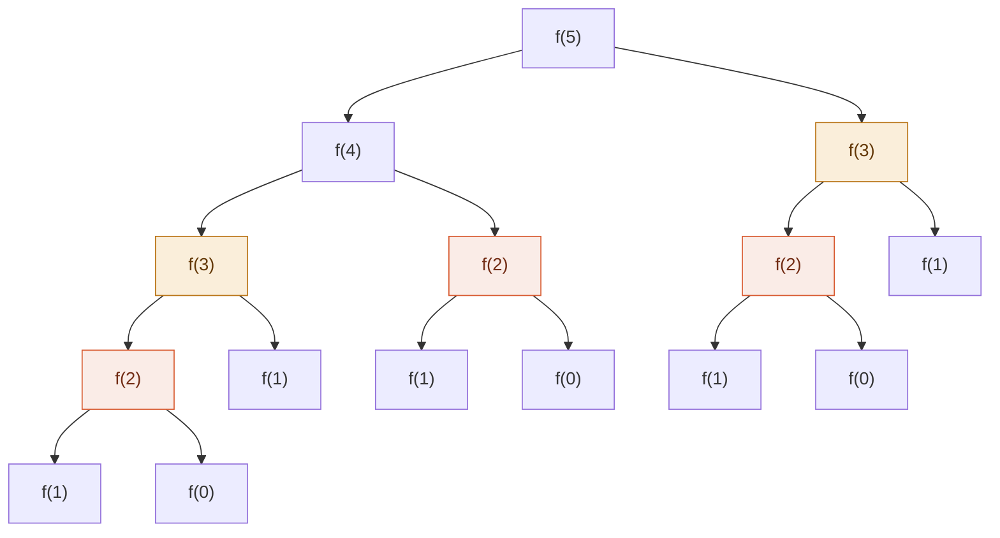

# 費氏數列：為什麼直覺的遞迴寫法這麼慢

## 先講結論

照著定義寫的遞迴版本，會把同一題**重複算非常多次**，時間是 O(2ⁿ)：n 每加 1，工作量大約多一倍。

解法是**把算過的答案記下來**，下次直接查，每個數只算一次，時間降到 O(n)。

| 寫法 | 時間 | 算第 50 個 |
| --- | --- | --- |
| 沒有記憶的遞迴 | O(2ⁿ) | 約 400 億次呼叫，要等好幾十分鐘 |
| 有記憶的遞迴 | O(n) | 約 50 次計算，一瞬間 |
| 迴圈由小算到大 | O(n) | 約 50 次計算，一瞬間 |

---

## 費氏數列是什麼

一串數字，每個數都等於前兩個數相加：

| 第幾個 | 0 | 1 | 2 | 3 | 4 | 5 | 6 | 7 | 8 | 9 |
| --- | --- | --- | --- | --- | --- | --- | --- | --- | --- | --- |
| 數字 | 0 | 1 | 1 | 2 | 3 | 5 | 8 | 13 | 21 | 34 |

例如第 5 個是 5，因為第 3 個（2）加第 4 個（3）等於 5。

### 生活中的例子：爬樓梯

爬樓梯時，每次可以跨 1 階或 2 階。爬到第 n 階總共有幾種走法？

要站上第 n 階，最後一步只有兩種可能：從第 n−1 階跨 1 階上來，或從第 n−2 階跨 2 階上來。所以：

**爬到第 n 階的走法 = 爬到第 n−1 階的走法 + 爬到第 n−2 階的走法**

這跟費氏數列的規則一模一樣。很多「大問題可以拆成兩個小問題」的情境，都會長出費氏數列的形狀。

---

## 直覺的寫法：照著定義寫

```python
def fib(n):
    if n <= 1:
        return n                      # 第 0 個是 0，第 1 個是 1
    return fib(n - 1) + fib(n - 2)    # 第 n 個 = 前一個 + 前兩個
```

`fib` 在自己裡面又呼叫自己，這叫做**遞迴**：要算第 n 個，就先去算第 n−1 個和第 n−2 個；要算這兩個，又各自去算它們的前兩個……一直拆到第 0、1 個，直接知道答案為止。

寫法很短、很好懂，但非常慢。

---

## 為什麼慢：同一題被算了好幾次

下面是算 `fib(5)` 時，所有被呼叫過的計算。`f(n)` 代表 `fib(n)`：



黃色的 `f(3)` 算了 2 次，橘色的 `f(2)` 算了 3 次。每一次都從頭算起，因為程式**沒有記住**之前算過的答案。

| 計算 | f(5) | f(4) | f(3) | f(2) | f(1) | f(0) |
| --- | --- | --- | --- | --- | --- | --- |
| 被呼叫幾次 | 1 | 1 | 2 | 3 | 5 | 3 |

只是算第 5 個，就呼叫了 15 次。n 越大，重複得越誇張：

| 要算第幾個 | 答案 | 總共呼叫幾次 |
| --- | --- | --- |
| 第 5 個 | 5 | 15 |
| 第 10 個 | 55 | 177 |
| 第 20 個 | 6,765 | 21,891 |
| 第 30 個 | 832,040 | 約 270 萬 |
| 第 50 個 | 約 126 億 | 約 400 億 |

### 為什麼是 O(2ⁿ)

每個呼叫都會分裂成兩個呼叫，像細胞分裂：1 變 2、2 變 4、4 變 8……從 n 一路拆到 0，大約要拆 n 層，所以總呼叫次數大約是 2ⁿ 的等級。

---

## 解法一：加上記憶（準備一本筆記本）

每算出一個答案，就寫進筆記本；下次要用時，先翻筆記本，有的話直接拿來用，不重算。

```python
memo = {}                         # 筆記本：第幾個 → 答案

def fib(n):
    if n in memo:                 # 筆記本裡有，直接用
        return memo[n]
    if n <= 1:
        result = n
    else:
        result = fib(n - 1) + fib(n - 2)
    memo[n] = result              # 算完寫進筆記本
    return result

print(fib(50))                    # 12586269025，一瞬間就算完
```

這樣一來，`f(3)` 只有第一次需要真的計算，第二次直接查筆記本；`f(2)` 也一樣。每個數只真的算一次，第 0 到第 n 個共 n+1 個數，所以時間是 **O(n)**。

這個技巧叫做**記憶化（memoization）**，用一點記憶體（筆記本）換取大量時間。

---

## 解法二：由小算到大（用迴圈）

換個方向想：與其從第 n 個往回拆，不如從第 0、1 個開始往上算，一路算到第 n 個。手上隨時只需要記住「前兩個數」。

```python
def fib(n):
    a, b = 0, 1           # a 是目前這個數，b 是下一個數
    for _ in range(n):
        a, b = b, a + b   # 往前走一格：新的 a 是原本的 b，新的 b 是兩者相加
    return a

print(fib(50))            # 12586269025
```

`a, b = b, a + b` 的意思是：兩個新值都用「原本的 a 和 b」算好之後，再一起換上去。

| 走了幾格 | a | b |
| --- | --- | --- |
| 0 | 0 | 1 |
| 1 | 1 | 1 |
| 2 | 1 | 2 |
| 3 | 2 | 3 |
| 4 | 3 | 5 |
| 5 | 5 | 8 |

走 5 格後，a 就是第 5 個數 5。時間是 **O(n)**，而且只用兩個變數，不需要筆記本。

---

## 三種寫法比較

| 寫法 | 時間 | 額外記憶體 | 優點 | 缺點 |
| --- | --- | --- | --- | --- |
| 沒有記憶的遞迴 | O(2ⁿ) | O(n) | 最短、最像定義 | 非常慢 |
| 有記憶的遞迴 | O(n) | O(n) | 保留遞迴的寫法，只多一本筆記本 | n 很大時會超過遞迴層數上限 |
| 迴圈由小算到大 | O(n) | O(1) | 最快、最省記憶體 | 要換個方向思考 |

---

## 這個問題教我們什麼

費氏數列本身不常用，但「**同一個小問題被重複計算**」這種情況非常常見。只要發現這個現象，就可以考慮把答案記下來：

| 情境 | 重複計算什麼 | 記下來的方法 |
| --- | --- | --- |
| 爬樓梯有幾種走法 | 爬到某一階的走法 | 記憶化或由小算到大 |
| 網頁快取 | 同一個網頁被很多人重複讀取 | 存一份在快取，下次直接給 |
| 資料分析 | 同一個查詢在迴圈裡被執行很多次 | 先算一次存起來，迴圈裡直接查 |

---

## 常見問題

**Q：遞迴一定比較慢嗎？**
不是。慢的原因是「重複計算」，不是遞迴本身。有記憶的遞迴和迴圈一樣是 O(n)。

**Q：筆記本 `memo` 為什麼放在函式外面？**
放在函式裡面的話，每次呼叫 `fib` 都會建出一本新的空筆記本，記了也沒用。放在外面，所有呼叫才能共用同一本。

**Q：為什麼要先檢查 `n in memo`，再判斷 `n <= 1`？**
其實順序對結果沒有影響，第 0、1 個本來就很快。先查筆記本，是養成「有算過就不重算」的習慣。

---

## 進階

### 其實比 2ⁿ 慢一點點

每個呼叫雖然分裂成兩個，但兩邊不一樣深：`fib(n−2)` 那邊比 `fib(n−1)` 少一層，所以總次數比 2ⁿ 少一些，精確來說大約是 1.618ⁿ（1.618 是黃金比例）。不過它仍然是「n 每加 1，工作量就乘上一個固定倍數」的指數成長，所以習慣上寫成 O(2ⁿ)。

### Python 內建的記憶化

Python 的 `functools.lru_cache` 可以自動幫函式加上筆記本，不用自己寫 `memo`：

```python
from functools import lru_cache

@lru_cache(maxsize=None)
def fib(n):
    if n <= 1:
        return n
    return fib(n - 1) + fib(n - 2)
```

`@lru_cache(maxsize=None)` 放在函式上面，意思是「把這個函式每次的答案都記下來」。

### 遞迴層數的上限

Python 預設最多只能遞迴約 1,000 層。有記憶的遞迴算 `fib(5000)` 時，第一次會從 5000 一路呼叫到 0，超過上限，出現 `RecursionError`。所以 n 很大時，用迴圈由小算到大最安全。

### 動態規劃

「把大問題拆成小問題，記下小問題的答案，避免重複計算」這個想法，有一個正式的名字：**動態規劃（Dynamic Programming）**。記憶化（由大往小拆）和由小算到大，就是動態規劃最常見的兩種寫法。
