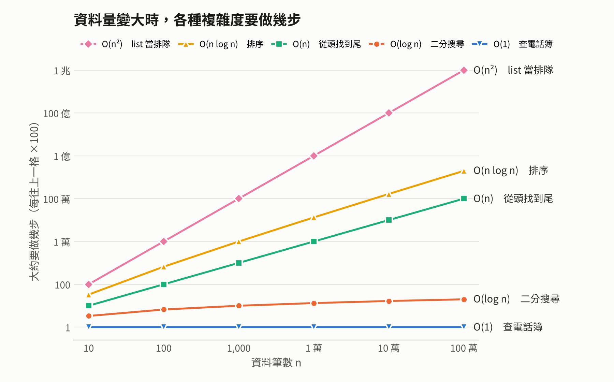
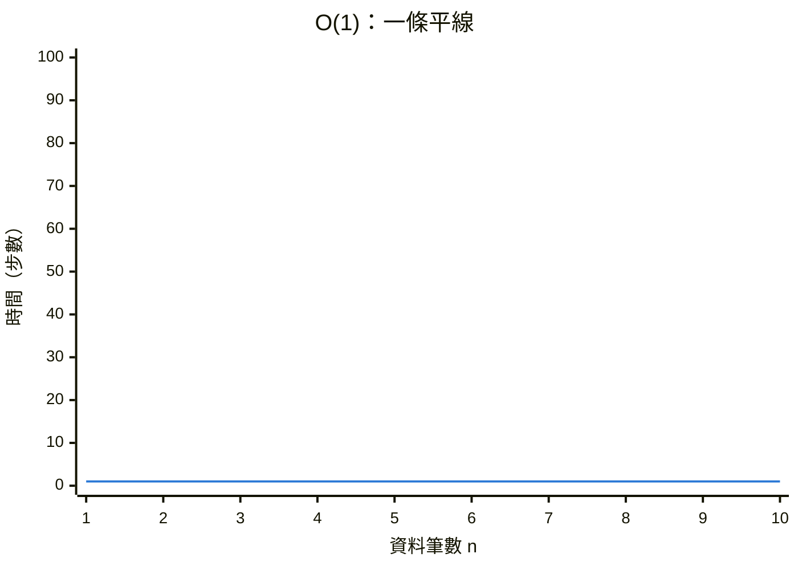
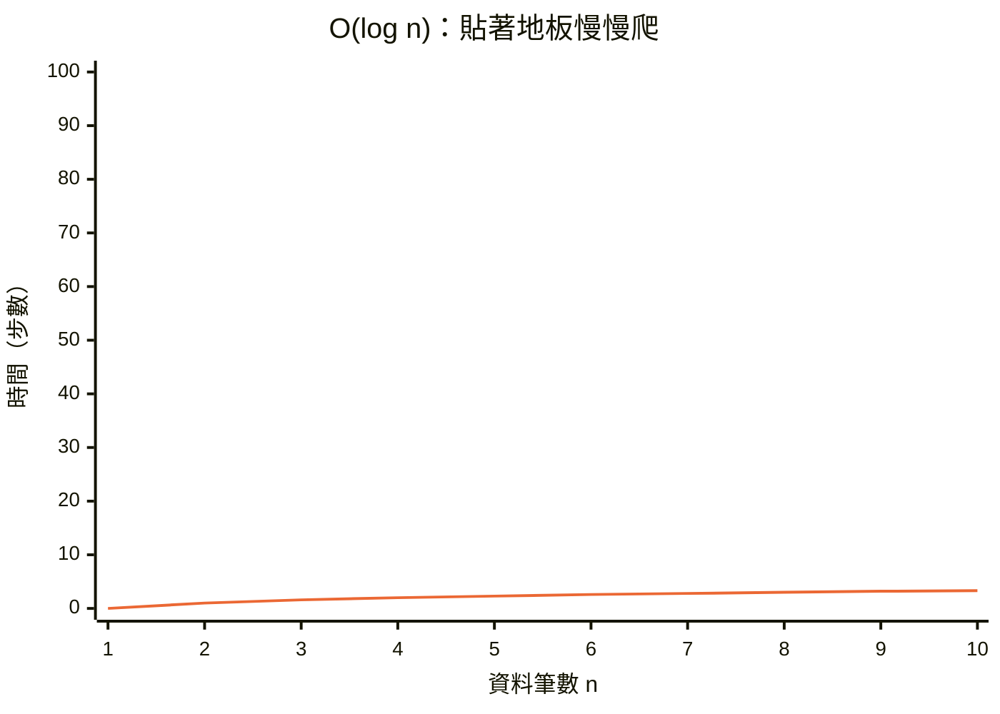
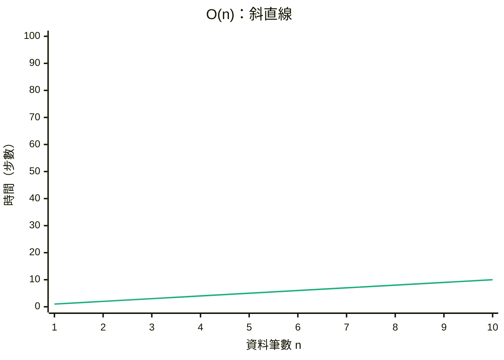
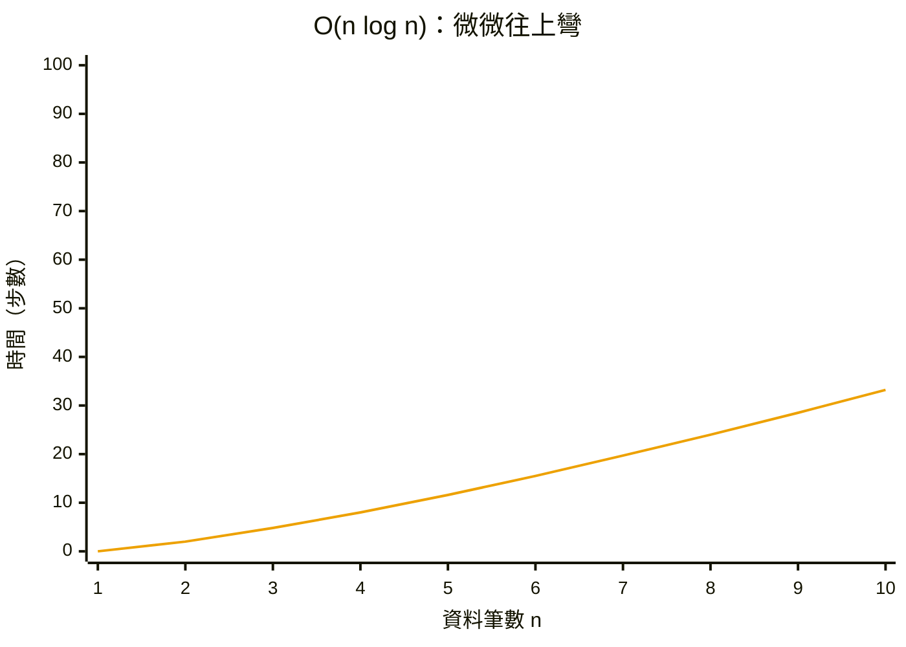
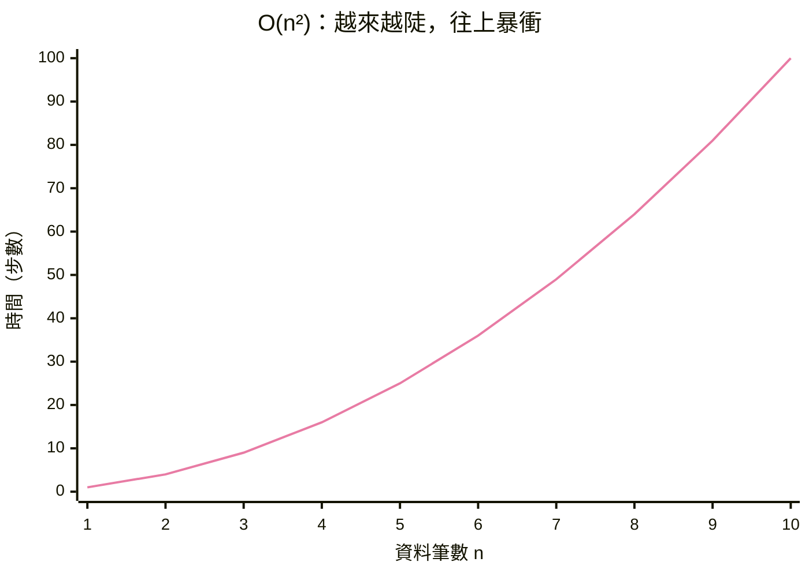
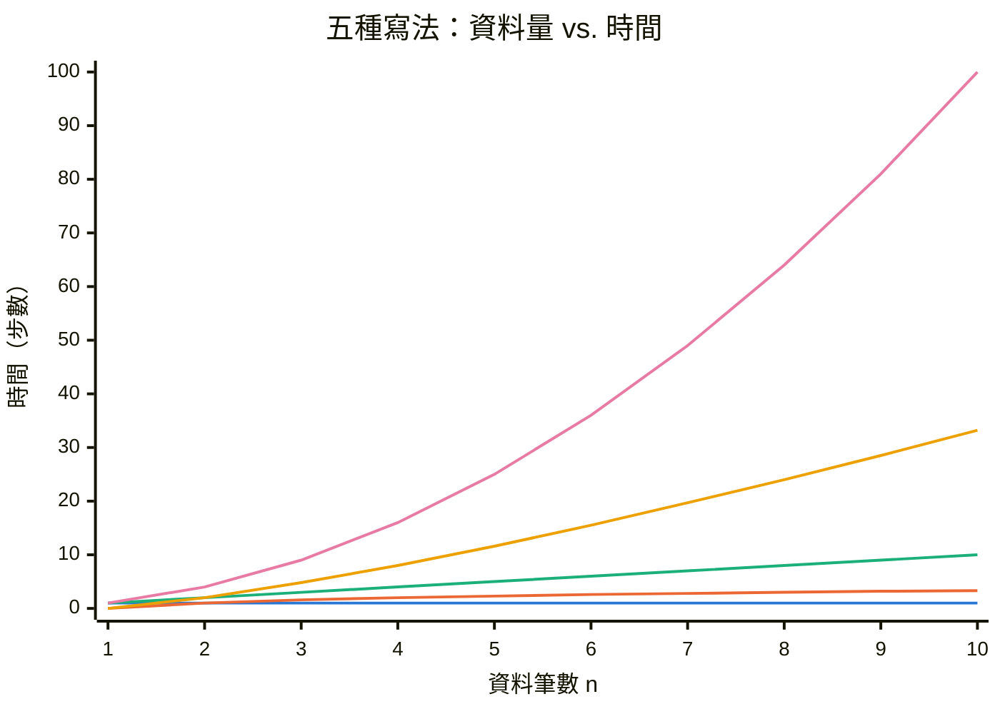

# 時間複雜度：資料越多，要花多少時間？

> 搭配〈組隊討伐 11/17 複盤筆記〉的 Q1、Q7 一起看。

## 先講結論

時間複雜度不是在算「幾秒」，而是在說「**資料變多時，時間怎麼跟著變**」。資料有幾筆寫作 n，O(…) 括號裡寫的就是時間跟 n 的關係。

| 寫法 | 時間跟資料量的關係 | 資料變 10 倍，時間變幾倍 | 生活比喻 |
| --- | --- | --- | --- |
| O(1) | 沒關係 | 1 倍（不變） | 用名字查電話簿，直接翻到那一頁 |
| O(log n) | 幾乎沒關係 | 只多一點點 | 猜 1～100 的數字，每次猜中間砍掉一半（Q1） |
| O(n) | 成正比 | 10 倍 | 在名單上從第一個人找到最後一個人 |
| O(n log n) | 比正比多一點 | 約 10～13 倍 | 把一疊考卷按分數排好（排序） |
| O(n²) | 跟資料量的平方成正比 | **100 倍** | 坐滿的電影院一排座位，前面的人每走一個，後面全部要往前挪（Q7） |

---

## 一張圖看懂

**怎麼讀這張圖**

- 橫軸：資料有幾筆，從 10 筆到 100 萬筆，每往右一格多 10 倍。
- 縱軸：大約要做幾步，每往上一格多 100 倍。
- 線越往右上爬得陡，代表資料一多就越慢。

**注意：縱軸是「乘」不是「加」**。如果用一般刻度畫，O(n²) 會瞬間衝出畫面，其他四條線全擠在底部變成一條直線，什麼都看不出來。所以圖上 O(n) 和 O(n²) 只隔幾格，實際上在 100 萬筆時差了 **100 萬倍**。

想看「一般刻度」下線的真實形狀，看下一節的小圖。

---

## 每種寫法長什麼樣子

下面五張小圖用**同一把尺**（縱軸都是 0 到 100），資料從 1 筆加到 10 筆，直接比較線的形狀。

### O(1)：時間跟資料量無關

資料再多都一步，是一條平線。

### O(log n)：資料變多，時間幾乎不動

每一步都砍掉一半。資料從 1 筆到 10 筆，只多了 3 步；從 100 筆到 100 萬筆，也只從 7 步變成 20 步。log n 的意思就是「n 可以對半切幾次」。

### O(n)：資料多幾倍，時間就多幾倍

每筆資料都看一次，是一條斜直線。

### O(n log n)：比直線再陡一點

排序通常是這個等級。比「每筆看一次」多一些工，但還算可以接受。

### O(n²)：資料一多，時間暴衝

每筆資料都要跟全部資料打交道。10 筆資料就要 100 步。

### 放在一起比

由下往上依序是 O(1)、O(log n)、O(n)、O(n log n)、O(n²)。

| 線的顏色 | 寫法 | 10 筆資料時的步數 |
| --- | --- | --- |
| 藍 | O(1) | 1 |
| 橘 | O(log n) | 3 |
| 綠 | O(n) | 10 |
| 黃 | O(n log n) | 33 |
| 粉紅 | O(n²) | 100 |

才 10 筆資料，O(n²) 就已經是 O(n) 的 10 倍，而且資料越多，差距越大。

---

## 資料變多時，差距會被放大

### 步數

| 資料筆數 n | O(1) | O(log n) | O(n) | O(n log n) | O(n²) |
| --- | --- | --- | --- | --- | --- |
| 10 | 1 | 3 | 10 | 33 | 100 |
| 100 | 1 | 7 | 100 | 664 | 1 萬 |
| 1,000 | 1 | 10 | 1,000 | 約 1 萬 | 100 萬 |
| 1 萬 | 1 | 13 | 1 萬 | 約 13 萬 | 1 億 |
| 10 萬 | 1 | 17 | 10 萬 | 約 166 萬 | 100 億 |
| 100 萬 | 1 | 20 | 100 萬 | 約 2,000 萬 | 1 兆 |

（log n 取以 2 為底。）

### 換成時間

假設電腦一秒能做 1 億步：

| 資料筆數 | O(n) | O(n log n) | O(n²) |
| --- | --- | --- | --- |
| 1,000 | 0.00001 秒 | 0.0001 秒 | 0.01 秒 |
| 10 萬 | 0.001 秒 | 0.017 秒 | 100 秒 |
| 100 萬 | 0.01 秒 | 0.2 秒 | **約 2.8 小時** |
| 1,000 萬 | 0.1 秒 | 2.3 秒 | **約 11.6 天** |

資料少的時候，用哪種方法感覺不出差別；資料一多，O(n²) 會從「一下下」變成「好幾天」。這就是 Q7 的重點：用 `deque.popleft()`（O(n)）一眨眼就做完，用 list 的 `pop(0)`（O(n²)）要等好幾個小時。這種問題常常要到資料變大才爆出來。

---

## 三個常見誤會

**「O(n) 就是要 n 秒」**
不是。O(…) 不管一步花多久，只管「資料變多時，步數變多的速度」。快電腦和慢電腦秒數不同，但資料多 10 倍時，O(n) 都會大約慢 10 倍。

**「O(log n) 和 O(n) 差不多吧，反正都會變大」**
差很多。100 萬筆時，一個 20 步，一個 100 萬步。O(log n) 幾乎跟 O(1) 一樣好。

**「題目問單一次，跟問全部做完是一樣的」**
不一樣。Q7 單次 `pop(0)` 是 O(n)，但題目問「取完全部 n 筆」，就是做 n 次 O(n)，總共 O(n²)。讀題時要看清楚問的是「一次」還是「全部」。

## 一句話記住

- 看到 O(n²) 就要警覺：資料多 10 倍，時間多 100 倍。
- 想變快，通常不是買更快的電腦，而是換一個線比較平的方法，例如 Q7 把 list 換成 deque。
